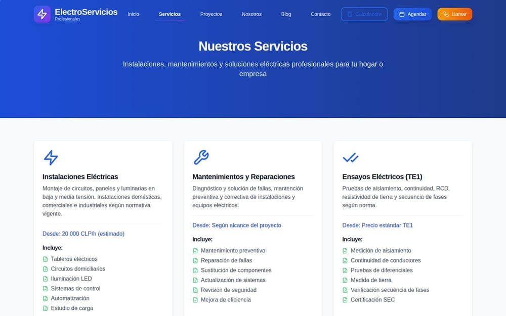
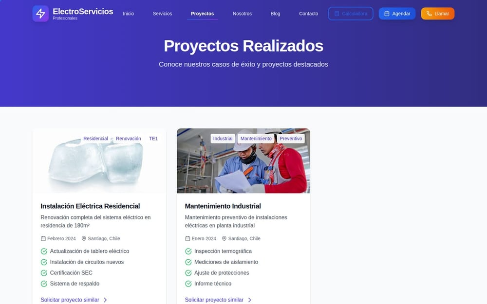
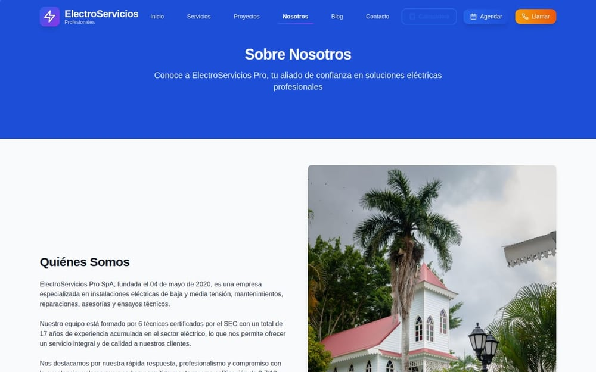
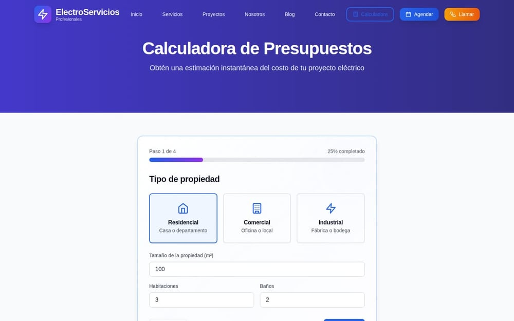
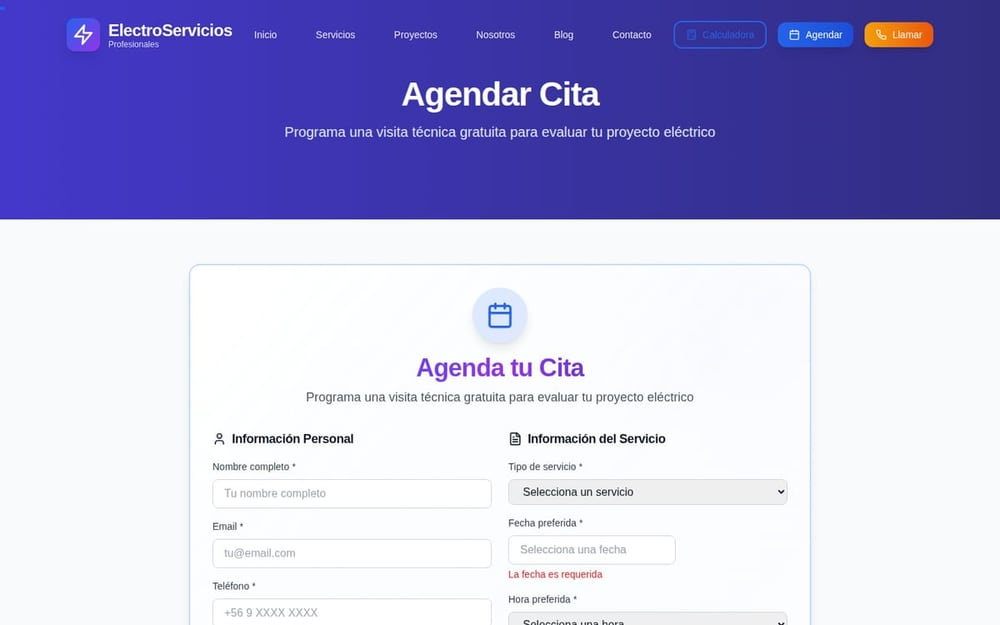
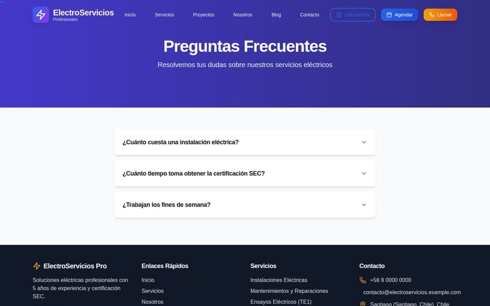
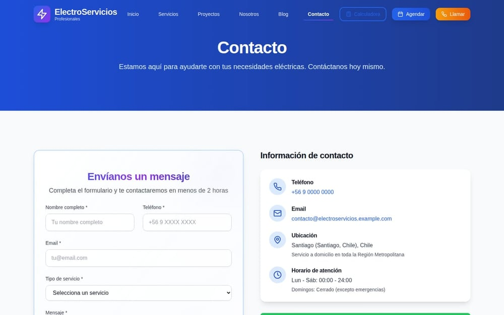
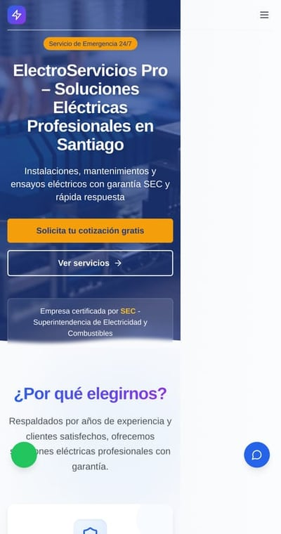
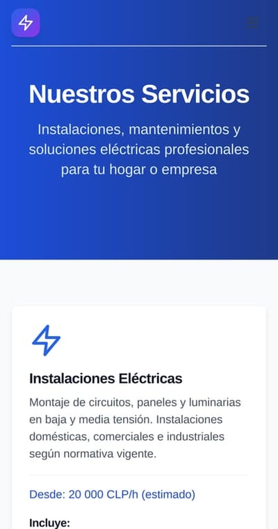
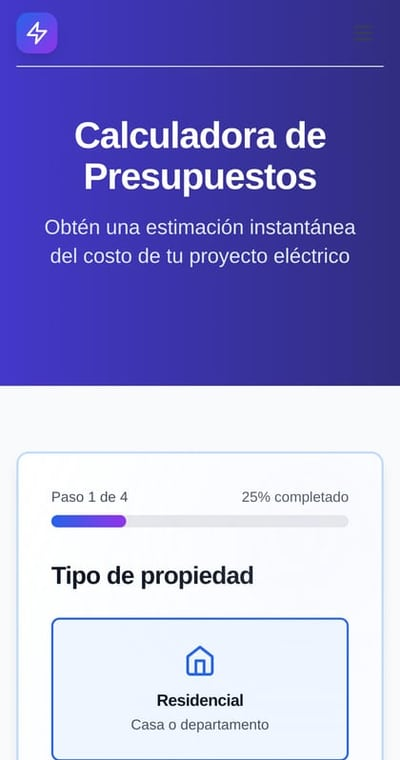

# ElectroServicios Pro Platform

> **Escaparate público.** Versión de portafolio de este producto para demostrar diseño,
> arquitectura y flujos. No incluye infraestructura, configuración ni credenciales.

**Electrical services web with booking & payments**

**Version:** 1.0.0 · **Year:** 2026 · **Status:** DEVELOPMENT

## Overview

A business-oriented frontend for an electrical services provider: marketing site, appointment booking, budget calculator, Supabase auth, Stripe webhook edge functions, and PWA configuration for offline behavior.

## Vitrina — capturas y documentación técnica

**[`vitrina/`](vitrina/README.md)** reúne la presentación pública del producto: 11 capturas del
sitio compilado (desktop y móvil), arquitectura, módulos y ficha técnica.

| Documento | Contenido |
|---|---|
| [`vitrina/README.md`](vitrina/README.md) | Presentación, capturas, qué resuelve, alcance |
| [`vitrina/docs/ARQUITECTURA.md`](vitrina/docs/ARQUITECTURA.md) | Capas y decisiones de diseño |
| [`vitrina/docs/FUNCIONALIDADES.md`](vitrina/docs/FUNCIONALIDADES.md) | Módulos y para quién existe cada uno |
| [`vitrina/docs/FICHA-TECNICA.md`](vitrina/docs/FICHA-TECNICA.md) | Stack, métricas y límites conocidos |

Las capturas se generan automáticamente con Playwright desde el build; no son montajes manuales.

### Galería

**Escritorio**

| <a href="vitrina/screenshots/home.jpg"></a><br><sub><b>Portada</b></sub> | <a href="vitrina/screenshots/servicios.jpg"></a><br><sub><b>Servicios</b></sub> | <a href="vitrina/screenshots/proyectos.jpg"></a><br><sub><b>Proyectos</b></sub> |
|---|---|---|
| <a href="vitrina/screenshots/nosotros.jpg"></a><br><sub><b>Nosotros</b></sub> | <a href="vitrina/screenshots/calculadora.jpg"></a><br><sub><b>Calculadora</b></sub> | <a href="vitrina/screenshots/citas.jpg"></a><br><sub><b>Citas</b></sub> |
| <a href="vitrina/screenshots/faq.jpg"></a><br><sub><b>Preguntas frecuentes</b></sub> | <a href="vitrina/screenshots/contacto.jpg"></a><br><sub><b>Contacto</b></sub> | &nbsp; |

**Móvil**

| <a href="vitrina/screenshots/mobile-home.jpg"></a><br><sub><b>Móvil · Portada</b></sub> | <a href="vitrina/screenshots/mobile-servicios.jpg"></a><br><sub><b>Móvil · Servicios</b></sub> | <a href="vitrina/screenshots/mobile-calculadora.jpg"></a><br><sub><b>Móvil · Calculadora</b></sub> |
|---|---|---|

*11 capturas del build real. Cada imagen abre la versión completa; todas están en [`vitrina/screenshots/`](vitrina/screenshots).*

## Architecture

The codebase follows a component-based architecture with typed domain models and service abstractions ready for backend integration. See the `docs/`, `src/`, or `app/` directories for the module structure.

## Tech Stack

React · TypeScript · Vite · Supabase · Stripe · PWA

## Key Features

- `web` · `services` · `bookings`


## Escaparate público — estado verificado (2026-10-23)

| Comprobación | Resultado |
|---|---|
| `npm run build` | ✅ exit 0 |
| Rutas SPA servidas | 12/12 (200) |
| Assets del index | existen (JS 995 KB · CSS 106 KB) |
| Sourcemaps publicados | **0** (antes 25 archivos / 4,7 MB con el código fuente) |
| Peso del build | **1.104 KB** (antes 5.864 KB) |
| Placeholders de configuración en el bundle | 0 |

### Qué se reparó

La copia pública **no compilaba**. Causas, en orden:

1. **Código cortado por la sanitización**: el import de `ResetPassword.tsx` estaba partido en dos
   líneas (`CheckCirc` / `le`) y `Register.tsx` terminaba con un residuo `</b`.
2. **Ruta a un archivo inexistente**: `App.tsx` hacía `import('./pages/Dashboard')`; el dashboard
   fue removido por privacidad. Se quitó la ruta y el dashboard quedó preservado en
   `src/_no-publicado/` (no se borró).
3. **Stripe con clave falsa**: se pasaba `'pk_test_...'` a `loadStripe`. Ahora usa `getStripe()`,
   que devuelve `null` sin clave y no rompe el árbol de React.
4. **Auth colgada**: sin Supabase, `supabase.auth.getSession()` dejaba la UI en `loading` para
   siempre. Ahora `supabaseConfigurado` decide y las pantallas de acceso muestran un aviso de
   demostración.
5. **Sourcemaps en producción**: el build publicaba 4,7 MB de `.map` — cualquiera podía leer el
   código fuente desde DevTools. Desactivados.

### Cómo correrlo

```bash
npm install
npm run build     # compila y verifica (script propio)
npm run preview   # sirve el resultado
npm run test      # vitest (tests existentes)
```

### Alcance

Escaparate **sin backend**: formularios de contacto y citas simulan el envío, la autenticación
está desactivada y el pago no se inicializa. La versión privada mantiene Supabase, Stripe,
panel de cliente y seguimiento de técnicos.

## Project Status

**DEVELOPMENT** — under active development (MVP / prototype stage).

## Technical Highlights

- Typed TypeScript architecture with reusable component system
- Client-first product experience with service abstractions for future backends
- Modern build tooling and code-quality conventions
