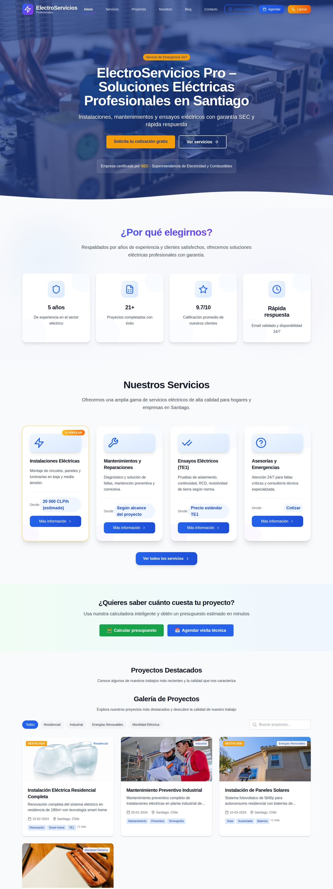
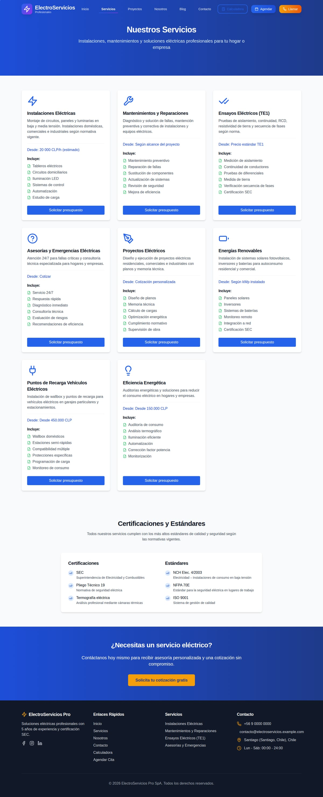
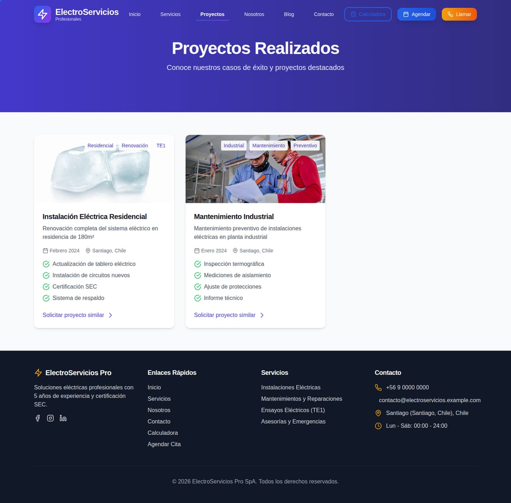
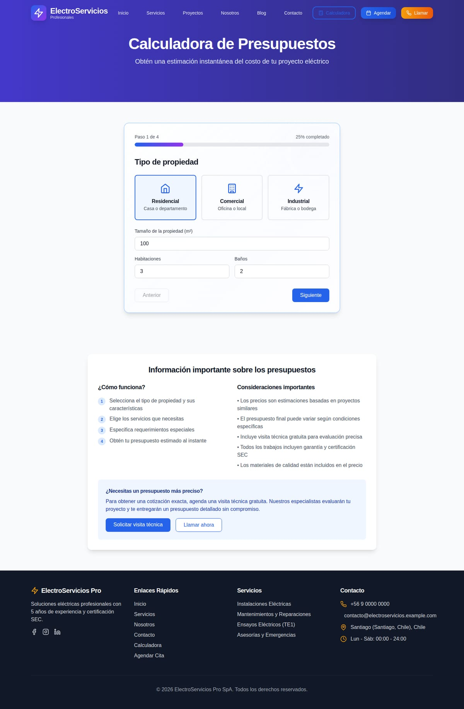
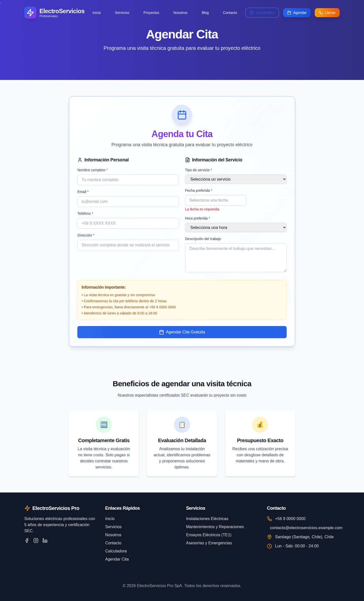
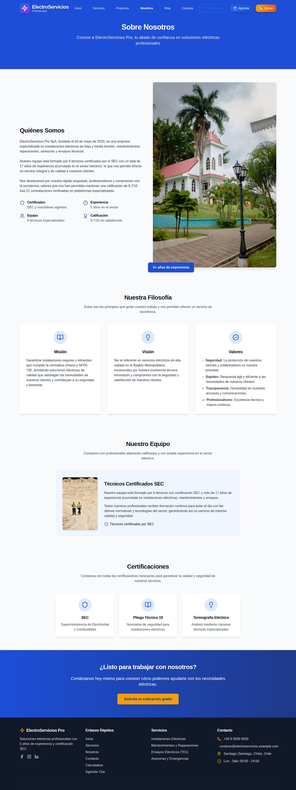
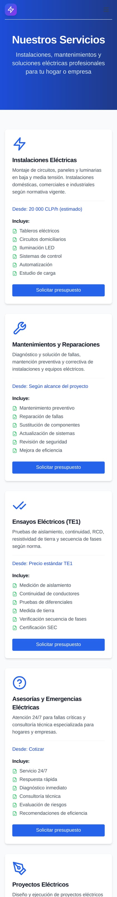
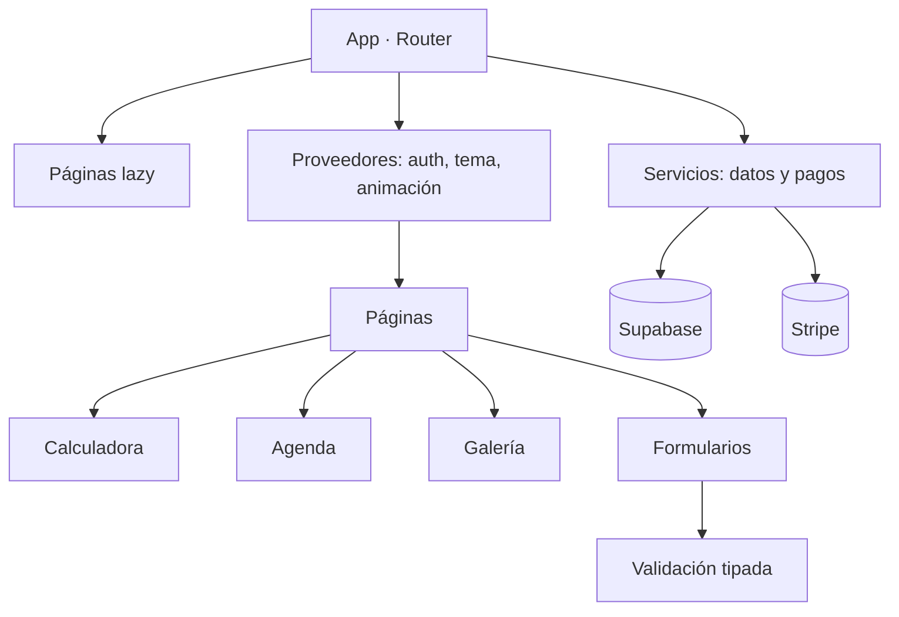

# ElectroServicios Pro — plataforma web para empresa eléctrica

> Escaparate de un sitio de servicios eléctricos con captación de leads, calculadora de
> presupuesto, agenda de visitas, pagos en línea y área de cliente. React + Vite, arquitectura
> preparada para Supabase y Stripe.

| | |
|---|---|
| **Tipo** | Aplicación web SPA con captación, cotización y agenda |
| **Stack** | React 18 · Vite · TypeScript · Tailwind CSS · Supabase · Stripe |
| **Páginas** | 12 rutas (públicas + autenticación) |
| **Estado** | Escaparate funcional: compila, renderiza y navega sin backend conectado |
| **Alcance** | Demostración. Pagos, base de datos y correo funcionan en modo simulado |

## Qué resuelve

Una empresa eléctrica pierde cotizaciones porque el cliente no sabe cuánto costará su trabajo y
no quiere esperar una llamada. Este sitio resuelve esa fricción en el mismo recorrido:

1. **Llega** → portada con propuesta de valor clara y prueba social.
2. **Entiende** → servicios con detalle, galería de proyectos y certificaciones.
3. **Calcula** → estimación de presupuesto guiada por tipo de trabajo y superficie.
4. **Agenda** → selección de fecha y hora con formulario por pasos.
5. **Paga o deja sus datos** → flujo de pago preparado y captura de lead con validación.
6. **Vuelve** → área de cliente con autenticación.

## Capturas

### Portada

### Servicios

### Proyectos y galería

### Calculadora de presupuesto

### Agenda de visitas

### Preguntas frecuentes

### Contacto

### Nosotros

### Móvil
| Portada | Servicios | Calculadora |
|---|---|---|
|  |  |  |

## Módulos

| Módulo | Para qué existe |
|---|---|
| **Captación de leads** | formulario con validación por pasos y clasificación del interés |
| **Calculadora de presupuesto** | estimación por tipo de trabajo, superficie y urgencia |
| **Agenda de visitas** | calendario con selección de fecha, hora y datos de contacto |
| **Galería de proyectos** | antes/después con visor ampliado y filtros por tipo de obra |
| **Pagos** | flujo de cobro preparado para Stripe (modo demostración sin claves) |
| **Área de cliente** | registro, inicio de sesión y recuperación de contraseña |
| **WhatsApp y chat** | canal directo de contacto sin salir de la página |
| **SEO** | metadatos por ruta, datos estructurados y sitemap |
| **PWA** | instalable y con soporte sin conexión |
| **Analítica** | medición de eventos de conversión (cotización, agenda, contacto) |

## Cómo está construido

- **Carga diferida por ruta**: cada página es un fragmento propio; el usuario solo descarga lo que visita.
- **Estado y datos separados**: los formularios validan con un esquema tipado y la capa de datos vive fuera de los componentes.
- **Proveedores en la raíz**: autenticación, animación y pagos se declaran una vez; las páginas los consumen.
- **Degradación limpia**: sin claves de Stripe la aplicación funciona; el cobro se desactiva en vez de romper la interfaz.

Detalle en [`docs/ARQUITECTURA.md`](docs/ARQUITECTURA.md),
[`docs/FUNCIONALIDADES.md`](docs/FUNCIONALIDADES.md) y
[`docs/FICHA-TECNICA.md`](docs/FICHA-TECNICA.md).

## Alcance de esta versión

Es una **vitrina**: demuestra diseño, arquitectura y flujos completos. No incluye backend activo,
base de datos con datos reales ni claves de pago. Los formularios validan y confirman, pero no
envían información a ningún servidor.

## Créditos de imágenes

Las fotografías son de **Pexels**, bajo su [licencia libre](https://www.pexels.com/license/).
Se usan como material de demostración, no como registro de trabajos reales.

## Contacto

Soluciones Industriales Prime JC — [solinprimejc.com](https://solinprimejc.com)
